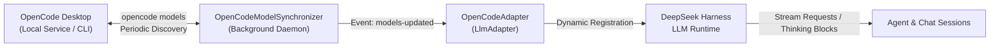
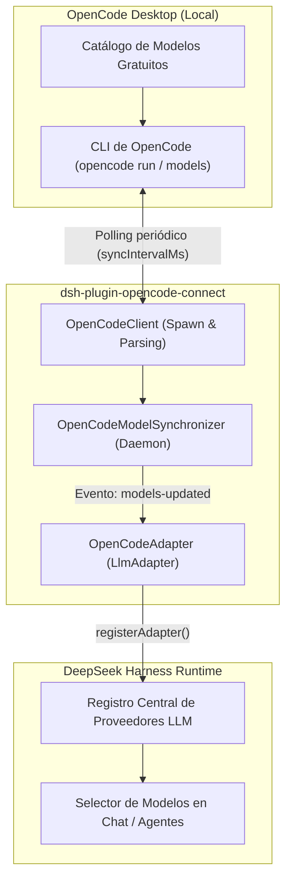

# Opencode Connect (`dsh-plugin-opencode-connect`)

<div align="center">

[](LICENSE)
[](https://www.deepseek.com/en/harness/)
[](https://opencode.ai)
[](https://github.com/Dreftian/Opencode-Connect)
[](https://github.com/Dreftian/Opencode-Connect)

**Seamlessly connect and dynamically auto-sync all OpenCode Desktop free models into DeepSeek Harness.**

[English Documentation](#english) • [Documentación en Español](#español)

</div>

---

<a name="english"></a>
## 🇬🇧 English Documentation

### 📌 Overview & The Problem It Solves

**DeepSeek Harness** is a high-performance orchestration framework and desktop workspace for advanced AI agents, multi-step reasoning, and software development workflows. However, developers often face friction with paywalled APIs, rate limits, credit-card requirements, or complex authentication setups for secondary models.

**OpenCode Desktop** provides an extensive, curated suite of free LLM models optimized for coding, reasoning, long-context analysis, and multimodal tasks. 

**OpenCode Connect (`dsh-plugin-opencode-connect`)** bridges this gap:
- **Zero API Keys Required**: Seamlessly leverages your existing local OpenCode Desktop instance.
- **10+ Free Pre-Configured Models**: Instantly exposes high-capability free models into DeepSeek Harness with no billing or subscription requirements.
- **Dynamic Auto-Synchronization**: Automatically monitors and syncs models whenever OpenCode Desktop updates its model registry, changes configurations, or introduces new free models—with zero restarts required.
- **Native DeepSeek Harness Streaming**: Full integration with Cordis and DeepSeek Harness protocols, featuring real-time token streaming and reasoning/thinking traces (`thinking_delta` & `text_delta`).

---

### 🧠 Supported OpenCode Desktop Free Models

The plugin automatically discovers and maps the complete catalog of free models from OpenCode Desktop:

| Model ID | DeepSeek Harness Name | Context Window | Thinking / Reasoning | Modality | Best For |
| :--- | :--- | :---: | :---: | :---: | :--- |
| `opencode/beam-free` | Beam Free [Free] | 32,768 | ❌ | Text | Ultra-fast responses, linting, concise edits |
| `opencode/big-pickle` | Big Pickle [Free] | 65,536 | ✅ | Text | Balanced algorithmic coding & problem solving |
| `opencode/deepseek-v4.1-flash-free` | DeepSeek V4.1 Flash Free [Free] | 131,072 | ✅ | Text | High-throughput code synthesis & agent planning |
| `opencode/glm-5.3-flash-free` | GLM-5.3-Flash Free [Free] | 131,072 | ✅ | Text | Deep reasoning, multilingual translation, code review |
| `opencode/longcat-2.5-preview-free` | LongCat 2.5 Preview Free [Free] | 262,144 | ❌ | Text | Massive context comprehension, full-repo analysis |
| `opencode/mimo-v2.6-flash-free` | MiMo-V2.6-Flash Free [Free] | 131,072 | ✅ | Text | Low-latency chat & reactive interactive agents |
| `opencode/nemotron-3-ultra-free` | Nemotron 3 Ultra Free [Free] | 65,536 | ✅ | Text | Enterprise code analysis & complex architecture |
| `opencode/nemotron-3.5-lightning-free` | Nemotron 3.5 Lightning Free [Free] | 65,536 | ❌ | Text | Instant snippet generation & documentation |
| `opencode/nemotron-3.5-super-vl-free` | Nemotron 3.5 Super VL Free [Free] | 65,536 | ✅ | Text, Image | UI/UX mockups, visual debugging, charts |
| `opencode/space-bunny-free` | Space Bunny Free [Free] | 65,536 | ✅ | Text | Creative engineering, prompt design, test suites |

---

### 🔄 Dynamic Auto-Synchronization Engine



1. **Auto-Discovery on Boot**: On initialization, `OpenCodeModelSynchronizer` invokes `opencode models` via standard local CLI paths across Windows, macOS, and Linux.
2. **Differential Comparison**: Keeps a snapshot of known models and computes differences. If OpenCode rolls out a new model version or introduces a new free tier model, the synchronizer emits a `models-updated` event.
3. **Hot Registry Refresh**: DeepSeek Harness updates its active provider catalog dynamically. Users can immediately select newly added models in the dropdown selector without reloading the application.

---

### 🚀 Installation Instructions for DeepSeek Harness

#### Method 1: Via DeepSeek Harness GUI (Recommended)
1. Open **DeepSeek Harness Desktop**.
2. Click on **Complementos** (Plugins) in the left navigation sidebar.
3. Click the **+ Agregar complemento** (+ Add Plugin) button in the upper right.
4. In the text field, paste the official GitHub repository URL:
   ```text
   https://github.com/Dreftian/Opencode-Connect
   ```
   *(Alternatively, you can provide the package name `dsh-plugin-opencode-connect` if published, or the path to a local directory).*
5. Click **Instalar** (Install). DeepSeek Harness will install the plugin and automatically detect your OpenCode Desktop models.

---

#### Method 2: Via DeepSeek Harness CLI / Cordis Patch
Using the DeepSeek Harness CLI toolchain:
```bash
# Using pnpm
pnpm dsh plugin add dsh-plugin-opencode-connect

# Or using npm
npm install --save dsh-plugin-opencode-connect
```

Or apply the included bundle patch in your `cordis.patch.yml`:
```yaml
- insert:
    - id: llm-opencode-connect
      name: dsh-plugin-opencode-connect
```

---

#### Method 3: Local Directory Path Installation (Development / Offline)
To run or develop from source:
```bash
# Clone the repository
git clone https://github.com/Dreftian/Opencode-Connect.git
cd Opencode-Connect

# Install dependencies and build
npm install
npm run build
```

Then in DeepSeek Harness GUI:
1. Navigate to **Complementos** > **+ Agregar complemento**.
2. Select **Cargar desde directorio local** (Load from local folder) or paste the absolute path:
   ```text
   C:\Users\<YourUser>\path\to\Opencode-Connect
   ```
3. Click **Confirmar**.

---

### ⚙️ Configuration Options

Configuration can be specified in your Cordis / DeepSeek Harness configuration file (`cordis.yml` or plugin options):

```yaml
dsh-plugin-opencode-connect:
  # Path to opencode or opencode-cli executable.
  # Leave empty ("") to auto-detect across standard installation paths.
  cliPath: ""

  # Background synchronization polling interval in milliseconds.
  # Default: 30000 (30 seconds)
  syncIntervalMs: 30000

  # Filter only free models provided by OpenCode Desktop.
  # Default: true
  onlyFreeModels: true

  # DeepSeek Harness LLM provider prefix ID.
  # Default: "opencode"
  providerPrefix: "opencode"

  # Human-readable provider display name.
  # Default: "OpenCode Desktop"
  providerDisplayName: "OpenCode Desktop"

  # Enable streaming of internal reasoning/thinking tokens.
  # Default: true
  enableThinking: true

  # Per-request execution timeout in milliseconds.
  # Default: 180000 (3 minutes)
  timeoutMs: 180000

  # Diagnostic log level ('debug' | 'info' | 'warn' | 'error').
  # Default: "info"
  logLevel: "info"
```

---

### 🛠️ Troubleshooting & Diagnostics

#### 1. "OpenCode CLI binary not found"
- **Cause**: OpenCode Desktop might be installed in a custom non-standard directory, or not yet launched.
- **Solution**: 
  - Ensure **OpenCode Desktop** is installed and has been run at least once so it extracts its CLI helper.
  - Specify the explicit binary path in your config (`cliPath: "C:\\path\\to\\opencode-cli.exe"` or `/usr/local/bin/opencode-cli`).
  - Standard auto-detected locations:
    - **Windows**: `%LOCALAPPDATA%\Programs\@opencodedesktop\resources\opencode-cli.exe` or `%APPDATA%\ai.opencode.desktop\cli\*\opencode-cli.exe`
    - **macOS**: `~/Library/Application Support/ai.opencode.desktop/cli/*/opencode-cli` or `/Applications/OpenCode.app/Contents/Resources/opencode-cli`
    - **Linux**: `~/.config/ai.opencode.desktop/cli/*/opencode-cli` or `/usr/bin/opencode-cli`

#### 2. "Rate limit exceeded / FreeUsageLimitError"
- **Cause**: Free tier models may have temporary usage windows during peak hours.
- **Solution**: The plugin automatically detects quota errors and notifies DeepSeek Harness with an HTTP 429 status. You can switch to another free model (e.g. from `deepseek-v4.1-flash-free` to `glm-5.3-flash-free` or `beam-free`) without interruptions.

#### 3. Verifying Auto-Synchronization
- Open the DeepSeek Harness developer console or log viewer.
- Trigger `opencode models` in a terminal to confirm OpenCode CLI outputs the model list.
- Check the log for:
  ```text
  [dsh-plugin-opencode-connect] Synced 10 free models from OpenCode Desktop
  ```

---

<a name="español"></a>
## 🇪🇸 Documentación en Español

### 📌 Visión General y Problema que Resuelve

**DeepSeek Harness** es un entorno de desarrollo y orquestación de agentes de IA de última generación para flujos de codificación y razonamiento autónomo. No obstante, los desarrolladores suelen enfrentarse a barreras como suscripciones de pago, cuotas restringidas o configuraciones tediosas de claves de API al utilizar modelos secundarios o de apoyo.

**OpenCode Desktop** incluye un ecosistema completo de modelos LLM completamente gratuitos diseñados para codificación rápida, razonamiento estructurado, comprensión de repositorios gigantescos y visión multimodal.

**OpenCode Connect (`dsh-plugin-opencode-connect`)** soluciona este problema:
- **Cero Claves de API**: Aprovecha directamente tu instalación local de OpenCode Desktop sin necesidad de tarjetas ni suscripciones.
- **Más de 10 Modelos Gratuitos**: Integra modelos potentes y de alta velocidad directamente en los selectores y agentes de DeepSeek Harness.
- **Sincronización Automática Dinámica**: Detecta automáticamente adiciones, cambios o actualizaciones de modelos en OpenCode Desktop en tiempo real, sin reiniciar DeepSeek Harness.
- **Streaming y Pensamiento Nativo (Thinking)**: Soporte completo para streaming en tiempo real y trazas de razonamiento (`thinking_delta` y `text_delta`).

---

### 🧠 Modelos Gratuitos Compatibles de OpenCode

El plugin detecta y activa automáticamente el catálogo completo de modelos gratuitos:

| ID del Modelo | Nombre en DeepSeek Harness | Ventana de Contexto | Pensamiento (Thinking) | Modalidad | Caso de Uso Recomendado |
| :--- | :--- | :---: | :---: | :---: | :--- |
| `opencode/beam-free` | Beam Free [Free] | 32,768 | ❌ | Texto | Ediciones rápidas, formateo de código, respuestas directas |
| `opencode/big-pickle` | Big Pickle [Free] | 65,536 | ✅ | Texto | Algoritmos complejos y razonamiento general |
| `opencode/deepseek-v4.1-flash-free` | DeepSeek V4.1 Flash Free [Free] | 131,072 | ✅ | Texto | Planificación de agentes, refactorización y lógica central |
| `opencode/glm-5.3-flash-free` | GLM-5.3-Flash Free [Free] | 131,072 | ✅ | Texto | Revisión profunda de código y tareas bilingües |
| `opencode/longcat-2.5-preview-free` | LongCat 2.5 Preview Free [Free] | 262,144 | ❌ | Texto | Análisis masivo de repositorios completos y logs extensos |
| `opencode/mimo-v2.6-flash-free` | MiMo-V2.6-Flash Free [Free] | 131,072 | ✅ | Texto | Asistente interactivo ultra-rápido en chat |
| `opencode/nemotron-3-ultra-free` | Nemotron 3 Ultra Free [Free] | 65,536 | ✅ | Texto | Diseño arquitectónico y razonamiento empresarial |
| `opencode/nemotron-3.5-lightning-free` | Nemotron 3.5 Lightning Free [Free] | 65,536 | ❌ | Texto | Generación instantánea de snippets y documentación |
| `opencode/nemotron-3.5-super-vl-free` | Nemotron 3.5 Super VL Free [Free] | 65,536 | ✅ | Texto, Imagen | Comprensión de interfaces, diagramas y capturas de pantalla |
| `opencode/space-bunny-free` | Space Bunny Free [Free] | 65,536 | ✅ | Texto | Generación creativa de pruebas y lógica modular |

---

### 🔄 Arquitectura y Sincronización Automática



---

### 🚀 Instrucciones de Instalación en DeepSeek Harness

#### Método 1: Desde la Interfaz Gráfica (Recomendado)
1. Abre **DeepSeek Harness Desktop**.
2. En la barra de navegación izquierda, dirígete a **Complementos**.
3. Haz clic en el botón superior **+ Agregar complemento**.
4. Pega la URL del repositorio oficial de GitHub:
   ```text
   https://github.com/Dreftian/Opencode-Connect
   ```
   *(También puedes indicar el nombre del paquete `dsh-plugin-opencode-connect` o la ruta local de tu equipo)*.
5. Haz clic en **Instalar**. El plugin se registrará de inmediato y comenzará a sincronizar tus modelos gratuitos de OpenCode.

---

#### Método 2: Mediante CLI de DeepSeek Harness / Cordis Patch
Ejecuta en tu terminal del entorno DeepSeek Harness:
```bash
# Con pnpm
pnpm dsh plugin add dsh-plugin-opencode-connect

# O con npm
npm install --save dsh-plugin-opencode-connect
```

O registra el parche en tu archivo `cordis.patch.yml`:
```yaml
- insert:
    - id: llm-opencode-connect
      name: dsh-plugin-opencode-connect
```

---

#### Método 3: Instalación desde Directorio Local (Desarrollo / Offline)
Si deseas compilar o personalizar el código fuente:
```bash
# Clonar el proyecto
git clone https://github.com/Dreftian/Opencode-Connect.git
cd Opencode-Connect

# Instalar dependencias y compilar
npm install
npm run build
```

Luego, en DeepSeek Harness:
1. Ve a **Complementos** > **+ Agregar complemento**.
2. Selecciona tu carpeta local de instalación:
   ```text
   C:\Users\<TuUsuario>\ruta\a\Opencode-Connect
   ```
3. Haz clic en **Confirmar**.

---

### ⚙️ Opciones de Configuración

Puedes personalizar los parámetros del plugin dentro de la configuración de Cordis / DeepSeek Harness:

```yaml
dsh-plugin-opencode-connect:
  # Ruta explícita al binario de OpenCode CLI.
  # Dejar en blanco ("") para autodetección en rutas del sistema.
  cliPath: ""

  # Intervalo de sondeo para sincronización automática en milisegundos.
  # Por defecto: 30000 (30 segundos)
  syncIntervalMs: 30000

  # Filtrar únicamente los modelos de capa gratuita de OpenCode.
  # Por defecto: true
  onlyFreeModels: true

  # Identificador de prefijo del proveedor en DeepSeek Harness.
  # Por defecto: "opencode"
  providerPrefix: "opencode"

  # Nombre visible en la lista desplegable de proveedores.
  # Por defecto: "OpenCode Desktop"
  providerDisplayName: "OpenCode Desktop"

  # Transmitir bloques de razonamiento/pensamiento interno (thinking).
  # Por defecto: true
  enableThinking: true

  # Límite máximo de tiempo por solicitud en milisegundos.
  # Por defecto: 180000 (3 minutos)
  timeoutMs: 180000

  # Nivel de registro ('debug' | 'info' | 'warn' | 'error').
  # Por defecto: "info"
  logLevel: "info"
```

---

### 🛠️ Guía de Solución de Problemas (Troubleshooting)

#### 1. "No se encuentra el binario de OpenCode CLI"
- **Causa**: OpenCode Desktop está en una ruta personalizada o nunca se ha iniciado en esta máquina.
- **Solución**:
  - Abre **OpenCode Desktop** al menos una vez para que extraiga sus herramientas de línea de comandos.
  - Si usas una instalación portátil, añade la propiedad `cliPath: "C:\\ruta\\a\\opencode-cli.exe"` en la configuración del plugin.
  - Rutas estándar comprobadas automáticamente:
    - **Windows**: `%LOCALAPPDATA%\Programs\@opencodedesktop\resources\opencode-cli.exe` o `%APPDATA%\ai.opencode.desktop\cli\*\opencode-cli.exe`
    - **macOS**: `~/Library/Application Support/ai.opencode.desktop/cli/*/opencode-cli` o `/Applications/OpenCode.app/Contents/Resources/opencode-cli`
    - **Linux**: `~/.config/ai.opencode.desktop/cli/*/opencode-cli` o `/usr/bin/opencode-cli`

#### 2. Límite de uso o cuota temporal ("Rate limit exceeded")
- **Causa**: Durante horas punta, un modelo gratuito específico puede alcanzar un límite temporal de peticiones por minuto.
- **Solución**: El plugin intercepta el error `429` limpiamente. Simplemente selecciona otro modelo gratuito disponible en la lista desplegable (por ejemplo, cambia de `deepseek-v4.1-flash-free` a `glm-5.3-flash-free` o `beam-free`) y continúa trabajando.

#### 3. Cómo Verificar la Sincronización Automática
- Abre la consola de desarrollo o los registros de DeepSeek Harness.
- Al iniciar, verás la traza de sincronización:
  ```text
  [dsh-plugin-opencode-connect] Synced 10 free models from OpenCode Desktop
  ```
- Si OpenCode añade o actualiza modelos, la lista en el selector de chat se renovará de inmediato sin necesidad de recargar la aplicación.

---

### 🧪 Tests & Desarrollo

```bash
# Compilar TypeScript
npm run build

# Ejecutar suite de pruebas unitarias
npm test
```

---

### 📄 Licencia

Este proyecto está distribuido bajo la licencia [MIT](LICENSE).  
Desarrollado y mantenido por [Dreftian](https://github.com/Dreftian).
